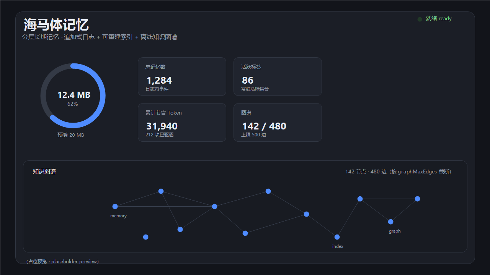
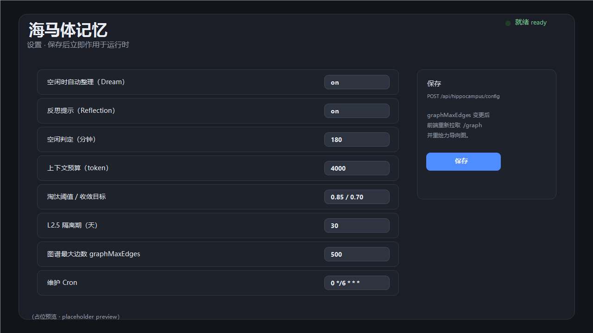
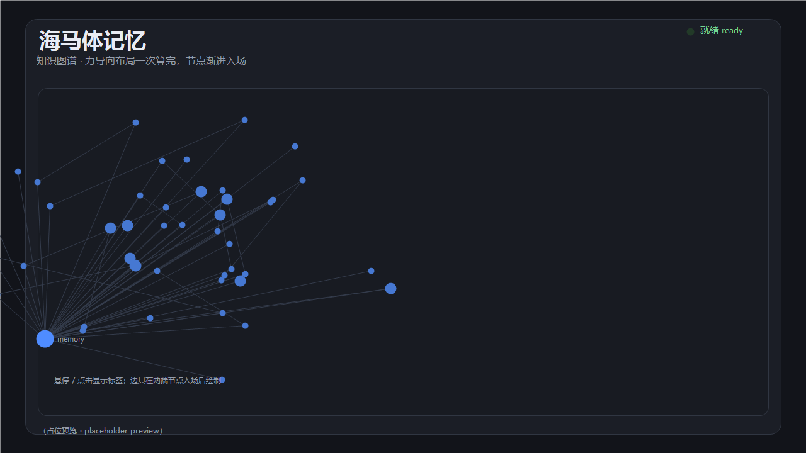

# dsh-layers-hippocampus · 海马体记忆

给 DeepSeek Harness（DSH）智能体的**分层长期记忆**：追加式事件日志、可重建标签索引、按天日记、独立语义层、L2.5 趋势隔离、离线知识图谱，以及一个完整的 Web 面板。

| | |
| --- | --- |
| 版本 | **1.5.6** |
| 包名 | `dsh-layers-hippocampus`（npm 只允许小写；仓库名保留 `dsh-Layers-Hippocampus`，*Hippocampus* 双 **p**） |
| 仓库 | <https://github.com/382quaii/dsh-Layers-Hippocampus> |
| 许可证 | MIT |
| 运行时依赖 | **零**。Host 半边只用 Node 内置模块，React 由 Harness 提供 |
| 详细设计 | [docs/ARCHITECTURE.zh.md](docs/ARCHITECTURE.zh.md) |

---

## 安装

### 从 GitHub

```bash
pnpm add "github:382quaii/dsh-Layers-Hippocampus#v1.5.6"
```

### 从 npm

```bash
pnpm add dsh-layers-hippocampus
```

### 通过插件管理器（推荐）

```
plugin_manager action=install_bundle target="C:\Users\86135\Documents\deepseek-harness\default-workspace\dsh-memory"
```

安装后 profile 会得到这一行：

```yaml
- insert:
    - id: hippocampus
      name: "dsh-layers-hippocampus"
      config:
        briefing: true
```

Host 半边随下一次宿主启动生效；UI 半边在页面加载时从 boot graph 取得。**冷启动后**用下面的脚本确认路由已就绪：

```bat
node scripts/wait-for-routes.mjs
```

---

## 工具

| 工具（`memory_*`） | 用途 |
| --- | --- |
| `remember` | 追加一条长期记忆（内容哈希幂等）；可带 `media_url` + `media_type` 指向附件；`pinned: true` 表示“永不衰减、命中标签时置顶”的经验教训（**必须带 tags**，否则 `MEM_E_PINNED_TAG_REQUIRED`） |
| `checkpoint` | 记录**唯一**进行中的重任务：`task_id`、`progress`（0–100）、`updated_at` |
| `space_transfer` | 跨空间原子迁移：`event_ids` + `target_space_id` + `transfer_mode: copy \| move`；**必须 `user_approved: true`**（AI 自行调用会被引擎拦截）；隐私词拦截、剥离 `raw_turn`、目标空间重新生成 `event_id` 并打标 |
| `transfer_to_global` | 迁移到 `global` 空间，参数与安全门禁同 `space_transfer`（`memory_transfer_to_global`） |
| `recall` | 关键词 + 标签检索，衰减加权，含图谱联想；宽限中 mid 的命中只回**元数据**并引导 `deep_raw`；`mode: "deep_raw"` 走受限 raw 扫描 |
| `capture` | 把**一轮原始对话**存入取证层（受门控与预算限制，不进索引） |
| `reinforce` | 确认一次记忆，不重写内容，并推进复习档位 |
| `forget` / `restore` | 两阶段删除（`pending_delete` 倒计时）与取消/反墓碑 |
| `admin` | `status` / `maintain` / `active_tags` / `semantic` / `active_task` / `reviews` / `pending_deletes` |

### 原始回合留存（raw）与 `deep_raw`

- **极简黑匣子**：每行恰为 `{ turn_id, timestamp, role, content }`；不写 tags / salience / decay / event_id / 图谱关系 / metadata。寻址用 `(日期文件, 行号)`——append-only 保证行号稳定（这是“禁止行号指针”在 raw 层的唯一合法例外）。
- 独立日分片 `raw/YYYY-MM-DD.jsonl`，**不进主日志、不进索引、启动不加载**；只有 `deep_raw` 和 `maintain()` 的 TTL 会读它。
- **异步写盘**：捕获只入内存队列，每 10 条或 1 秒批量 `appendFile`，绝不阻塞 `session/event` 回调。
- **明文存储 + 读出脱敏**：落盘保留 100% 原文（黑匣子完整性）；`deep_raw` 返回前对 snippet 做脱敏（Bearer、`sk-`、长 base64 串 → `[redacted]`），防止密钥进入云端 prompt。**注意：本地磁盘为明文。**
- **墓碑**：`forget` 真正执行 purge 后，按内容 hash 追加 `{ type: "raw_tombstone", hash, timestamp }`；扫描时命中墓碑的记录直接跳过（防死灰复燃）。
- **时间窗**：`memory_recall mode="deep_raw"` 通常必须同时给 `start_time` 与 `end_time`，缺失抛 `MEM_E_INVALID_INPUT`；但若查询词命中**超级大标签**（关联数 > 500），缺失时间窗抛更具体的 **`MEM_E_TIME_RANGE_REQUIRED`**（1.5.0）——大标签裸扫正是要防的上下文/内存洪峰。
- **Token 预算**：结果上限 `raw.maxResultTokens`（默认 1000），超出截断并在 `notes` 末尾注明「由于预算限制，部分原始记录已被截断」。
- **最新优先扫描**：`deep_raw` 在分片内**从尾部倒序**扫描（日文件内越新越先看到），回合预算 `raw.maxScanTurns`（默认 5000，UI 可调）控制"从最新往回看多远"。超出预算返回 `truncated: true` + notes 说明，绝不假装更旧的数据不存在。1.4.3 前是头部正序扫描，大分片里最新的 5000 条永远查不到——黑匣子的核心价值被反转，已修复。
- **⚠ 尾扫偏置（明确的已知代价）**：单个日分片超过 `maxScanTurns`（默认 5000）时，一次 `deep_raw` **只能看到该分片最新的 N 条**；更早的历史记录不在本次扫描范围内，需要：① 调大 `raw.maxScanTurns`（上限 50 000）；或 ② 按时间窗**分页**查询——把 `end_time` 逐步前移、用多个时间窗分别扫描。返回体里 `truncated: true` 与 `notes` 会明确告知"本次没扫完"，绝不静默返回空。该偏置是"查新优先"的直接代价。
- **TTL**：`maintain()` 删除文件名日期早于 `今天 - retentionDays` 的整文件；**今天正在写的文件绝不删**。raw 体积计入 Dashboard 存储环（`panel.storage.rawBytes` + 总 `diskBytes`）。
- 自动捕获：订阅 `session/event`，只收 user/assistant 原文（剥离宿主注入的 `Current runtime context.` 段），工具输出默认不收、但 `isError` 的失败结果强制入库。

### 两阶段删除与间隔重复

- `forget` 先挂起（默认 24h，`delete.graceHours`），`restore` 在到期前直接取消；到期由 `maintain()` 推进到 tombstone→archive→consolidation→purge。未知 id 在挂起前就报 `MEM_E_NOT_FOUND`。
- 复习排期 `1,2,4,7,15,30` 天，持久化在 `state/reviews.json`；`reinforce` 推进一档，`maintain()` 汇总到期项，`memory_admin action="reviews"` 可查。

### 数据目录迁移（UI）

设置页 `dataDir` 可编辑：保存后返回 **202 + state=migrating**，后台 `fs.promises.cp` 拷贝、两端 `recordCount` 校验、写入 `.migration-complete` 后才切换 `dataDir` 并重开存储；校验失败删除目标、旧目录仍权威；源目录保留为备份。并发请求由 `.migration.lock` 阻断（`MEM_E_MIGRATION_LOCKED`），面板显示进度条。

`active_task` 直查底层索引，**不受活跃集合 cap 200 限制**；写入新 checkpoint 会降级旧记录，7 天未刷新由 `maintain()` 自动降级，模型的 `forget` 只是 happy path。

### 提示词软引导与自有工具瘦身

- 系统提示新增 `memory:policy`（静态段，保持前缀缓存稳定）：要求模型在需要回忆历史、查阅文件、获取系统信息时**优先调用 `memory_recall`**，禁止盲目读取外部超长文件或让原生工具输出全文。
- 本插件工具返回超长 JSON（默认 >2000 tokens）时，由 `slimToolPayload` 先**把完整内容写入 raw**，再返回带 `[Slimmed]` 的瘦身版：保留 `summary` / `topics` / `key_entities` / `recovery_hash`。
- 恢复原文：`memory_recall(mode="deep_raw", hash="…")`，按内容 sha256 精确返回；这是"软拦截"能覆盖的最大范围——其他插件的工具输出仍由宿主投射，插件无法改写。

### 多模态与防爆仓

- `media_url` 只接受 **http(s) URL 或绝对路径**；`media_type` ∈ `image | video | document | audio`，缺一即 `MEM_E_INVALID_MEDIA`。
- 内联 base64 **不落库**：`content` 中连续 base64 字符 ≥ **256** 即抛 `MEM_E_INVALID_MEDIA`；200 字符以内视为普通文本，不会误杀。

### 记忆流转（上下文 → 长期 → 联想 → 月记）

1. **推币机折叠**：上下文触发 evict 时被驱逐的块不再丢弃，引擎把最近一批折成一条 `folded_summary` 事件写回 L1（标签 `status:folded`），抽取人名、任务语句与核心结论。
2. **在线联想唤醒**：查询命中某个 Tag 时读取 `state/graph.json`，取该节点最强的 **3** 个邻居，把邻居事件以 **0.5 惩罚系数**放进候选池；命中标记 `association.via`，直连结果永远排在联想结果之前。
3. **月记（Monthly Memo）**：`maintain()` 发现某个自然月已完整，就把该月日记压成一条 `status:monthly` 记忆；月记**不参与日常衰减**（`decay = 1`），模糊时间查询（“上个月”“2023-10”“去年”）会优先召回它。

一切都从**唯一真相源**（追加式日志）派生；索引、日记、活跃标签集、知识图谱都是可丢弃、可重建的投影。

### 分层

1. **L1 事件日志**：追加式 JSONL 代际 + `CURRENT` 指针。
2. **L2 索引**：标签表、活跃集合、日记、墓碑；A/B 双缓冲，读者永远看不到半成品。
3. **L1.5 标签层级树**：root/mid/leaf 三层寿命 + 宽限幽灵；派生缓存，`state/tag-tree.json`。
4. **L2.5 趋势隔离**：短命观察，经晋升窗口与突发检测才升级为记忆（情景可删，模式不删）。
5. **L3 语义层**：摘要独立于原始日志生死。
6. **图谱**：标签共现网络的离线投影。

### L1.5 标签层级树与幽灵节点

层级标签按 `/` 解析为 **root / mid / leaf** 三层（`tech/frontend/vue3`），三种寿命：

- **root 永生**：`tech` 这类命名空间根，永不删除；无 `/` 的扁平标签（`project:dsh`）同样是受保护的根。
- **leaf 引用归零即死**：它的所有事件被遗忘后进入待修剪队列；`maintain()` 每次只消费 `tagTree.pruneBatchSize`（默认 100）条，队列落盘、跨重启分批排空——**绝不一次维护风暴**。
- **mid 宽限**：失去最后一个叶子后进入 `midGracePeriodDays`（默认 30 天）宽限期（`graceUntil`）。期内挂上新叶子会立即复活；期内它叫**幽灵节点（ghost）**，只存在于 `state/tag-tree.json` 的 `ghosts` 里；宽限到期且衰减低于地板后才真正消亡。
- **反幻觉降级**：`memory_recall` 对只经由宽限 mid 到达的命中，**整条正文（snippet/content）不会进入结果或提示词**，只返回一条元数据：`幽灵节点 path、共 N 条、宽限期还剩几天、deep_raw 时间窗`，引导模型去查原话。点名一个宽限 mid 却没有实体命中时，也返回 `count: 0` 的同一提示而不是静默空结果。
- **派生缓存**：整个标签树由 `maintain()` 从收敛后的索引投影，随后与上一份缓存**carry-forward**（已失去全部活引用的节点以 `refCount=0` 接回，孤儿丢弃），所以生命周期跨维护可观察。`state/tag-tree.json` 可随时删除——只会丢失幽灵历史，活树下次维护照常重建。

### 身份纪律

- `content_hash` 规范化（标签排序、文本规整）用于**等价**。
- `event_id = hash(content_hash + event_time + occurrence_index)` 用于**身份**。
- 重复写通过独立幂等索引抑制；墓碑在日志压实后仍然存在，遗忘的事件不会复活。

### 写入路径与耐久性（1.4.3）

- **`stage()` / `commitMany()`**：`remember` 先 `stage`（校验、身份解析、构造记录，不碰日志与索引），再 `commitMany`（**一次** durable append + **一次** ledger checkpoint + **一次** lazy 索引 delta + **一次** briefing 失效）。`bulkIngest` 每 50 条真正批量提交一次。
- **日志追加缓冲**：热路径只保留一个 append 句柄，不再每条 fsync + 重写 manifest；`flushSync()` 由 200ms 定时器、`close()`、以及任何 rewrite/compaction 触发。记录写入后**立即对本进程可读**（page cache），跨进程崩溃窗口 ≤ 200ms。
- **崩溃可见**：`status().unflushedBytes` 对比分片文件大小与 manifest 计数字节；boot check 看到未 checkpoint 的尾巴就判 stale 并重建，不会把"未写进 manifest 的尾记录"当成不存在。
- **identity ledger 延迟 checkpoint**（500ms / close）：它是可从日志重建的启动提示，不是真相源。
- **索引追加惰性化**：`applyRecords` 只记录 delta 并置 dirty，下一次 `snapshot()` 一次性折叠——N 次写只付一次建索引成本，且"写完即可读"由读路径保证。
- **实测**：顺序 `remember` ×1000 从 **119/s → 9104/s**（8.4s → 110ms）。

---

## v1.5.0：大标签治理、多空间路由与会话交接

### 1. 超级大标签（Tag Explosion）超载治理

- **索引层截断（防 OOM）**：倒排索引构建时，每个标签最多保留 `index.maxPostingsPerTag`（默认 **500**）个指针；超限时按 `salience desc → eventTime desc → eventId asc` 保留，再按检索序重排。`eventCount` / `mass` / `lastSeen` 仍按**全部事件**统计，因此降级提示里的 N 是真实总数；被移出的只是内存索引指针，**底层 JSONL 完好**，删索引重建即可恢复。标签带 `postingsLimit` / `postingsTruncated` / `postingsDropped`，索引 stats 带同名汇总。
- **检索层降级（防上下文爆炸）**：显式 `tags: ["big"]` 命中数 > **50** 时不再展开候选，返回元数据提示：`[系统提示] 发现关于 [big] 的记忆共 N 条，数据量过大。请提供更精确的 startTime/endTime 或使用 deep_raw 查阅。`（附该标签的 `window` 起止时间）；coarse-block 回退同时被抑制，避免洪峰从后门回来。若用户坚持（再次查询同一标签），只返回**最近 3 条摘要**（`oversizedRecent: true`）。
- **深层检索强制时间窗**：`deep_raw` 命中超级大标签（关联数 > **500**）且缺 `start_time`/`end_time` 时抛 **`MEM_E_TIME_RANGE_REQUIRED`**；窄查询保持原 `MEM_E_INVALID_INPUT` 契约。判断只有一处（引擎），工具不再重复校验。

### 2. 多空间路由与会话交接（纯物理层）

- **路由隔离**：`remember` / `recall` 支持可选 `target_space_id`（核心 API 为 `targetSpaceId`）。`default` 就是原有存储（旧路径字节不变），命名空间落在 `<dataDir>/spaces/<id>/`，各自独立日志/索引/状态。**每个空间一条 FIFO 文件锁**：同空间串行、跨空间并发，绝不交叉；`runMany` 按 id 排序加锁，杜绝 ABBA 死锁。id 会变成目录名，所以 `^[a-z0-9][a-z0-9._-]{0,63}$` 强校验，拼错直接 `MEM_E_INVALID_INPUT`，绝不静默落到默认空间。
- **原生保真与折叠（Qwen 模式）**：Token 低于 `context.nativeTokenLimit`（默认 8000）时**绝不折叠**——保留逐字原文；超过后自动走 L1.5 分层折叠。旧的 `context.maxTokens` 分页阈值完全不变。
- **自动交接（转生）**：达到 `autoRolloverThreshold`（默认 0.85）× `nativeTokenLimit` 时，把窗口末尾提炼成**一条** L1.5 摘要（`status:handoff`），写入 `state/handoff.json` 交接标记，并在 `memory-state` 提示词尾部注入 `[交接标记]`。交接幂等（一次交接只产一条摘要），由 `session/event` 与工具边界自动触发；新会话会消费标记。关闭交接则不写标记，由 ContextEngine 在 **95%** 强制驱逐（`reason: "native-force"`，驱逐到 `target × nativeTokenLimit`）。

### 3. 跨空间安全迁移（`memory_space_transfer`）

- `transfer_mode`: `copy`（默认）| `move`；**安检铁律**：隐私敏感内容（身份证/手机号/银行卡/邮箱/凭据赋值/PEM 私钥）整批拦截 `MEM_E_PRIVACY_BLOCKED`（命中的原文绝不回传）；`raw_turn`/`raw_*` 指针逐层剥离；目标空间重新生成 `event_id`（`dedupe:false`，绝不复用源身份）并打标 `transferred:from:<source>` / `transferred:to:<target>`。
- **状态差异**：`copy` 源数据原样保留；`move` 在**全部目标写入成功之后**把源数据挂入两阶段删除流水线（`pending_delete` 倒计时，可用 `restore` 取消），**绝不直接物理删除**；目标写入部分失败则源数据完全不动。

### 4. 安全红线：跨空间迁移必须显式用户授权（1.5.1）

跨空间传消息是**数据外发**，不是记忆优化，绝不允许 AI“自作主张”或“合理推测”。双重保险：

- **提示词层**：`memory:policy` 常驻 `【🚨最高安全红线】`——`memory_space_transfer` / `memory_transfer_to_global` 极度危险，**绝对禁止** AI 因自身判断、同情心或“为了更好地跨端共享记忆”而自动调用；唯一允许条件是用户在**当前对话**明确下令。不确定时必须先问：`您需要我把这条信息同步到其他空间吗？`
- **引擎层**：`context.requireExplicitConsentForTransfer`（默认 **true**）。为 true 时，任何未带 `user_approved: true` 的迁移调用都会被拦截并返回 **`MEM_E_REQUIRE_USER_CONSENT`**：`[系统拦截] 跨空间传递需要用户明确授权。请向用户确认后再试。` 该检查发生在**校验空间 id、打开存储、读取内容、挂起待删之前**——被拒绝的调用可证明零副作用。AI 看到此错误必须停下、向用户确认，得到明确同意后才能带 `user_approved: true` 重试。
- **UI 人工通道（1.5.2 起更强）**：面板记忆列表勾选 →「移动到…」→ 第一步提示“即将向 [目标空间] 发起迁移请求” → 第二步**二次显式确认**（剪切另有警告）→ 才带 `user_approved: true` 调 API。**HTTP 路由不再自行伪造授权**：缺这个标志的 POST 与 AI 工具调用一样被引擎拦截（`MEM_E_REQUIRE_USER_CONSENT`），因此“底层 API 绕过 UI”同样走不通；AI 也无法访问 HTTP 路由。

---

## 配置

全部由 `resolveConfig` **fail-fast 校验**（绝不静默取整），启动与 HTTP 热更新走同一个校验器。设置页覆盖了全部可编辑项。

| 键 | 默认 | 范围 / 取值 |
| --- | --- | --- |
| `dataDir` | `<DSH_HOME>/memory` | 绝对路径（只读，不在 UI 内编辑） |
| `migrateFrom` | `null` | 路径；留空时自动探测旧目录 |
| `maintenanceCron` | `0 */6 * * *` | 5 段 cron，必须能触发 |
| `briefing` / `promptSection` / `autoMaintainOnBoot` | `true` | 布尔 |
| `enableDream` | `true` | 布尔 |
| `dreamIdleMinutes` | `180` | 1 – 525 600 |
| `dream.compensateAfterHours` | `24` | 1 – 720；会话开始时若上次 Dream 超过该时长且价格窗口允许，补跑一次 Dream（`DSH_DREAM_PRICE=low\|high` 或注入价格探针） |
| `dream.useLlm` / `dream.*` 调优项 | 见默认值 | 设置页「离线 Dream（LLM 蒸馏）」可调：成组条数 / 组数 / 摘要与来源字数 / 超时 / 熔断 / 冷却 / 补偿阈值；**`dream.llm.{baseUrl,model,apiKey}` 永不下发浏览器**（1.5.6） |
| `enableReflection` | `true` | 布尔 |
| `graphMaxEdges` | `500` | 100 – 2000 |
| `storageBudgetMb` | `50` | 10 – 1000（软上限：超限只标红，不删档） |
| `decay.halfLifeDays` | `30` | 7 – 365；调大记得更久 |
| `activeSet.cap` | `200` | 100 – 1000；多项目并行可调 500（下次维护生效） |
| `maxRecallTopK` | `100` | 1 – 1000 |
| `retrieval.topK` | `20` | 1 – `maxRecallTopK` |
| `context.maxTokens` | `4000` | 256 – 1 000 000 |
| `context.maxInjectTokens` | `4000` | 256 – 100 000；单次 recall 返回 JSON 的硬上限，超限截断并带 `truncated:true` |
| `context.threshold` / `context.target` | `0.85` / `0.7` | target < threshold < 1 |
| `context.injectPrompt` | `true` | 布尔 |
| `context.autoSpaceFollow` | `false` | 布尔；开启后跨空间操作完成时 UI 自动切换空间 |
| `context.autoRolloverEnabled` | `true` | 布尔；关闭则 95% 时强制驱逐、不写交接标记 |
| `context.autoRolloverThreshold` | `0.85` | 0.5 – 0.99；× `nativeTokenLimit` 触发交接 |
| `context.nativeTokenLimit` | `8000` | 512 – 1 000 000；低于该 Token 数绝不折叠（Qwen 原生模式） |
| `context.requireExplicitConsentForTransfer` | `true` | 布尔；开启时 AI 直接调用迁移工具返回 `MEM_E_REQUIRE_USER_CONSENT`，仅 UI 人工通道放行（1.5.1） |
| `index.maxPostingsPerTag` | `500` | 1 – 100 000；每个标签在内存索引中最多保留的指针数 |
| `tools.disabled` | `[]` | 工具后缀数组（如 `["capture","bulk_ingest"]`）；核心 remember/recall/admin 不可关闭；未知/重复/带前缀名称 fail-fast 抛 `MEM_E_INVALID_TOOL_NAME` |
| `tagging.autoTag` | `true` | 布尔；未手传 tags 时由引擎从内容形态提取锚点（错误类型 / errno / 代码块语言 / HTTP 状态 / 文件路径 / 任务语句）（1.5.6） |
| `tagging.maxTags` | `2` | 1 – 5；每次自动打标最多输出的标签数；模型手传 tags 时启发式不运行 |
| `features.multiSpace` | `true` | 关闭后本体退化为严格单空间：非 `default` 的 targetSpaceId 一律 `MEM_E_FEATURE_DISABLED`，空间工具不注册（1.5.6） |
| `features.crossSpaceTransfer` | `true` | 关闭后 `space_transfer` / `transfer_to_global` 不注册、迁移引擎直接拒绝；关多空间时自动跟随关闭 |
| `l2Merge.enabled` | `true` | 维护时把同标签重复 L2 经验合并为一条；pinned 与普通严格分组，`meta.global_tags` 只进 meta 不进倒排（1.5.6） |
| `l2Merge.minGroupSize` / `maxGroupsPerRun` / `maxSummaryChars` | `2` / `5` / `400` | 2–20 / 1–50 / 100–2000；合并文本用 ASCII 省略号，受身份规范化后仍不超上限 |
| `temp.ttlDays` / `temp.promotionWindowDays` | `30` / `20` | promotion ≤ ttl |
| `identity.eventTimePolicy` | `content` | `content` \| `explicit` \| `ingest` |
| `raw.mode` | `salience` | `off` \| `salience` \| `all` |
| `raw.minSalience` | `0.6` | 0 – 1 |
| `raw.maxTurnKb` | `64` | 8 – 1024 |
| `raw.maxBytesPerDay` | `8` | 1 – 128 MB |
| `raw.maxTotalMb` | `256` | 16 – 4096 MB |
| `raw.retentionDays` | `30` | 1 – 365（按文件日期整文件清理） |
| `raw.maxScanMb` | `16` | 1 – 256 MB |
| `raw.maxScanTurns` | `5000` | 500 – 50 000；deep_raw 从最新往回的回合预算 |
| `raw.maxResultTokens` | `1000` | 50 – 20000 |
| `raw.autoCapture` | `true` | 布尔 |
| `raw.captureTools` | `false` | 布尔（`isError` 工具结果始终捕获） |
| `delete.graceHours` | `24` | 0 – 168（0 = 立即执行） |
| `review.enabled` | `true` | 布尔 |
| `tagTree.midHalfLifeMultiplier` | `3` | 1 – 10；mid 半衰期 = 倍率 × leaf 半衰期（1 天） |
| `tagTree.midGracePeriodDays` | `30` | 7 – 180；mid 失去最后一个叶子后的宽限天数（幽灵期） |
| `tagTree.pruneBatchSize` | `100` | 10 – 500；每次维护最多修剪的待删叶子数（有界批次） |
| `tagTree.leafDecayFloor` | `0` | 0 – 1；0 = 只按引用归零死亡，>0 时低于地板的排队叶子被修剪 |
| `migration.timeoutMs` | `600000` | 10000 – 3600000 |

错误码稳定：`MEM_E_CONFIG_INVALID_CRON`、`MEM_E_CONFIG_OUT_OF_RANGE`、`MEM_E_CONFIG_UNKNOWN_KEY` 等。

### 调度纪律

Cron **和** 空闲 Dream 触发调用同一个入口 `runtime.runMaintenance(source)`。执行中再次触发直接拒绝（`maintenance-in-flight`）——不排队、不补跑。

### 启动状态机（前后端协议）

`pending → in_progress → ready | failed`。

**每个 HTTP 响应都带 `state`**（包括 400/405/409/500）。前端**只按 `body.state` 决定重试**，不按状态码：

| `state` | 前端行为 |
| --- | --- |
| `pending` / `in_progress` | 2s 轮询 + Skeleton，不报错 |
| `ready` | 正常渲染 |
| `failed` | 1.2s × 5 次短重试，然后显示「重新连接 / 重试」 |
| 无 body 的 404 | 指数退避（1→2→4→5s 封顶）最多等 **10 分钟**，之后 `MEM_E_BOOT_TIMEOUT` + 手动重连 |

**写请求隔离**：`ready` 之前 `POST /config` 返回 `409 + MEM_E_NOT_READY + state`；工具返回同样带 `state` / `retryable` 的 `MEM_E_NOT_READY`——绝不静默吞掉。

> **冷启动 404 的根因（1.3.1 修复）**：`webServer` 由 web-app 行提供，而它在本插件 `apply()` **之后**才激活。旧代码只在 `apply()` 里 `ctx.get('webServer')` 一次，拿不到就静默跳过注册——冷启动永远没有路由，热重载却正常。现在注册放在 `ctx.inject(['webServer'], child => …)` 的子 fiber 里：服务一出现就注册。`apply()` 本身不 `await` 任何 I/O，bootstrap 由 `runtime.start()` 放进微任务。成功注册会打印 `[Hippocampus] Route registered at <iso> (…)`，失败会打印 `[Hippocampus] Route registration FAILED: <reason>`。
>
> 冷启动验证：重启 DSH 后运行 `node scripts/wait-for-routes.mjs`（自动找端口、自动带会话 Cookie）。它逐行打印状态，路由可用时输出 `OK: routes served … (state=ready)`；在此之前是 `state=(none)` 的 404，客户端会一直退避等待，不会 6 次就死锁。

---

## Web UI

三个注册，全部经 Harness 插槽服务：

| 插槽 | id / key | 内容 |
| --- | --- | --- |
| `sidebar.panellist` | `hippocampus-panel` | 图标（SVG，消费 `size` / `active`） |
| `main` | `hippocampus-panel` | 面板：存储环形图、统计卡、知识图谱 |
| `settings.section` | `hippocampus-settings` | 完整配置表单 |

- **环形图**：纯 SVG，预算来自 `storageBudgetMb`；中心同时显示用量与百分比，超预算时弧线截断为整圈并整体标红。
- **知识图谱**：力导向布局**只计算一次**并冻进 ref（弹簧 + 斥力 + 向心），随后节点逐个入场；边只在**两端节点都已入场**后绘制，不会有悬空线；孤立节点带随机抖动。
  - **拖拽**：`onPointerDown/Move/Up` + `setPointerCapture`；拖拽期间只改 ref 坐标并直接写 DOM（`transform` 与线段端点），**不触发 setState**；松手后解除 pin，对 1 跳邻域做 alpha 衰减的局部松弛；位移 < 4px 仍算点击（切换标签）。
  - **幽灵节点与历史开关**：图谱接口在同一次响应里带 `tagTree.ghosts`（渲染上限 50 条，含 `totalGhosts`/`truncated`）；"仅活跃 / 历史全貌"开关用 CSS `opacity` 420ms 过渡淡入淡出（布局键不含开关状态，切换**不会重排**）。历史里的 mid 渲染为半透明虚线圆，挂在父 root 下，hover 有 `title` 提示剩余宽限期。
- **设置页**：开关（Dream / Reflection / briefing / promptSection / autoMaintainOnBoot / injectPrompt）、数字（含上下限与客户端预检）、滑块 + 数字框（L1.5 四个寿命旋钮，label 的 `title` 是场景化 Tooltip）、下拉（`identity.eventTimePolicy`）、Cron 文本框；保存一次性提交带点号路径的 patch，后端 fail-fast 失败时顶部红色横幅显示 `MEM_E_CONFIG_*`，成功后广播 `config-changed`，面板立即重拉 stats 与 graph。
- **空间与会话交接（1.5.0）**：面板状态栏实时显示 `[当前: 原生模式 | 剩余 X Tokens 触发交接]`（另有两种文案：`分层折叠`、`已交接`）；设置页新增「空间与会话交接（纯物理层）」区：空间软跟随开关、自动交接开关、触发比例滑块、原生窗口、单标签索引上限。
- **全局空间选择器（1.5.2）**：面板 Header 的 `SpaceSelector` 手动切换当前空间（默认空间 / 工作空间 / 私人空间 / 新建空空间）；面板与设置页共用同一全局状态，所有读取（`stats` / `graph` / `memories`）都带 `?space=<id>` 后端路由隔离——记忆列表、图谱、L1/L2/L3 状态、会话计数严格跟随选中空间，切换不串流。
- **物理迁移与业务迁移彻底拆开（1.5.2）**：`dataDir` 迁移只在设置页底部的「系统级 · 存储位置迁移（dataDir / A-B 双缓冲）」里，严格绝对路径 + 空目录 Fail-Fast，旧目录保留备份，`state=migrating`。**业务记忆迁移**只在面板：勾选记忆 →「移动到…」→ 第一步显示「即将向 [目标空间] 发起迁移请求」→ 第二步**二次显式确认**（`二次确认 · 安全红线`，剪切另有警告）→ 才带 `user_approved: true` 发请求；不再有任何手动 `event_ids` / `target_space_id` 输入框。
- **工具 schema 裁剪（1.5.3）**：设置页新增「工具 schema 裁剪（tools.disabled）」复选目录，逐项说明核心不可关闭（remember/recall/admin）与低频可裁剪（capture/bulk_ingest/reinforce/space_transfer 等），并用 Tooltip 解释每个工具的用途与 token 底座税权衡；保存写回 `tools.disabled`，下次宿主启动/重载时跳过注册并从提示词工具清单中剔除。
- **空间创建热修（1.5.3）**：`POST /api/hippocampus/spaces` 失败不再裸奔 `MEM_E_SPACES: HTTP 404`。`/stats` 与 `GET /spaces` 返回 `capabilities`（version/spaces/memories/transferConsent），前端**调用前先握手**：旧宿主（不支持该路由）直接显示版本提示并禁用创建，不会打空请求；即使仍失败也统一转成「创建失败：底层引擎未响应，请检查版本或联系架构师」。后端对非法/保留/已存在名称抛 `MEM_E_SPACE_INVALID`（HTTP 400，写盘前拦截），成功创建返回 201。**注意：内核升级后需重启 DSH/重载插件，旧进程不会凭空长出 /spaces 路由。**
- **减法交互（1.5.0）**：图谱上方的标签搜索框只依赖宿主原生**回车**触发（`onKeyDown` + `Enter`），**没有防抖 / 定时器 / effect**；过滤是纯函数 `filterGraphByQuery`，不会重跑力布局。
- **逐条记忆人工迁移（1.5.1 / 1.5.2）**：面板“记忆详情”列表用勾选 +「移动到…」，目标空间来自下拉（含新建空间），完成后按软跟随开关决定是否切换；AI 自行调用只会收到 `MEM_E_REQUIRE_USER_CONSENT`，HTTP 路由也不再自行伪造授权（缺 `user_approved:true` 同样被引擎拦截）。
- **哲学底注**：设置页 Footer（加粗）：**本插件不能保证一个会话永生不死，只能保证人格不死。**
- UI 不调用 Agent 工具，只读下面的 JSON 路由。

### 截图







> 三张为**占位预览图**；替换 `assets/` 下同名 PNG 即可，`screenshots.json` 无需改动。

## HTTP API

挂在 Host Web 服务上的同源路由，复用宿主浏览器鉴权。**所有响应都带 `state`。**

| 方法 | 路径 | 返回 |
| --- | --- | --- |
| `GET` | `/api/hippocampus/stats?space=<id>` | `{ ok, state, phase, spaceId, panel, briefing, config }`；面板数据只属于该空间；未就绪 `503` |
| `GET` | `/api/hippocampus/config` | 可编辑配置子集（`ready` 前也可读，用于回填表单） |
| `POST` | `/api/hippocampus/config` | `{ patch }` → fail-fast 校验 → 生效 → 尽量持久化；`{ dataDir }` 单独请求 = 系统级物理迁移（202 / state=migrating） |
| `GET` | `/api/hippocampus/graph?space=<id>` | 该空间的缓存图谱，`.slice(0, graphMaxEdges)`；同时带 `tagTree.ghosts` |
| `POST` | `/api/hippocampus/retry` | 重试 `failed` 启动（`202`） |
| `POST` | `/api/hippocampus/transfer` | 业务数据跨空间迁移 `{ event_ids, target_space_id, transfer_mode, source_space_id?, user_approved }`；**缺 `user_approved:true` 由引擎拦截**（1.5.2 起路由不再代为授权） |
| `GET` | `/api/hippocampus/memories?limit=20&space=<id>` | 该空间的最近记忆投影（面板勾选迁移的数据源） |
| `POST` | `/api/hippocampus/session/reset` | 逃生舱：清零当前会话 token 基线、释放 in-flight 锁、消费 handoff.json（不删除记忆）；交接卡死时用（1.5.4） |
| `GET` / `POST` | `/api/hippocampus/spaces` | 列出物理空间 / 新建空空间 `{ space_id }`（成功 201；非法/保留/已存在 → 400 `MEM_E_SPACE_INVALID`；1.5.3 起 `/stats` 带 `capabilities` 供前端握手） |

图谱路由**不排序、不读日志**：缓存由 `maintain()` 写入，路由只做切片。

---

## 数据布局

```
<dataDir>/
  log/          gen-*/ + CURRENT          追加式真相
  index/        gen-*/ + CURRENT          A/B 投影
  identity/     ledger.json               幂等 + 墓碑
  semantic/     摘要 + temp.json          独立语义流
  state/        context.json、maintenance.json、graph.json、tag-tree.json、months.json、active-task.json、handoff.json
  spaces/       <spaceId>/…               命名空间的独立存储（default 不在此处，复用根目录）
  journal/      删除流水账
```

删掉 `index/`、`state/graph.json`、`state/tag-tree.json`、`state/months.json` 都安全：它们会从日志重建（月记会按已生成月份重新补齐；标签树会重建活树，只丢失幽灵历史）。

## 从旧名字迁移

存储位置不变（`<DSH_HOME>/memory`）。若数据在旧目录（`memory`、`dsh-memory`、`hippocampus`、`Layers-Hippocampus`、`dsh-Layers-Hippocampus`），在 `migrateFrom` 未设置且目标目录无数据时会**自动识别为迁移源**。迁移有 PID 存活锁与完成标记，可重复执行。

---

## 开发与验证

```bash
npm test      # node test/run.mjs —— 295 个进程内用例，60 秒看门狗
npm run bench # 基准协议：独立临时库 + 同进程预热 + 5 次取中位数
npm run check # 语法检查 + 全量测试
```

全部用例在进程内运行（不 spawn 子进程），时间相关测试一律注入 `FakeClock`，不读真实时钟、不访问网络。

冷启动验收：

```bash
node scripts/wait-for-routes.mjs            # 自动找端口
node scripts/wait-for-routes.mjs 55879      # 指定端口
```

raw 黑匣子整理（旧 15 字段记录 → 四字段 schema，剔除 tool 噪音 / 注入段落 / 测试残留，按内容去重）：

```bash
node scripts/compact-raw.mjs                 # 干跑，只打印计划
node scripts/compact-raw.mjs --apply         # 先备份到 raw/.backup-<ts>/ 再原地重写
node scripts/compact-raw.mjs --data-dir "D:\Users\86135\memory" --apply
```

基准协议（唯一被认可的吞吐量发布方式；单次跑出的数字一律视为噪声）：

```bash
npm run bench                                  # node scripts/bench-protocol.mjs，markdown 报告
node scripts/bench-protocol.mjs --json         # 原始样本
node scripts/bench-protocol.mjs --records 2000 --runs 5 --warmup 1
```

交接脏数据修复（默认 dry-run；`--apply` 后只进入 pending_delete 两阶段队列，仍可 restore）：

```bash
node scripts/repair-handoff.mjs --data-dir "<DSH_HOME>/memory"              # 只列出候选
node scripts/repair-handoff.mjs --data-dir "<DSH_HOME>/memory" --apply      # 归档递归/超额 handoff
node scripts/repair-handoff.mjs --data-dir "<DSH_HOME>/memory" --reset-marker  # 顺带清除卡住的 marker
```

协议固定为：每次测量独立临时库（跑完删除）→ 同进程预热 1 次（丢弃）→ 5 次测量取**中位数**并同时报告 min/max/离散度；任何只引用单一数字的结论都无效。脚本不对吞吐量做断言（共享机器/杀软扫描不能把 CI 弄红），只保证测量方法一致。

`context.minInjectConfidence` 已在 1.5.3 移除（从未证明省 Token，0.6 与 0 逐字节相同）；旧配置若仍带该键，启动会 fail-fast 报 `MEM_E_CONFIG_UNKNOWN_KEY` 并提示删除。

绑定/注册体检（检查 package.json 名、patch 行名、profile 依赖、Junction 与实时路由）：

```bash
node scripts/check-binding.mjs --port 55879
```

## 变更记录

见 [CHANGELOG.md](CHANGELOG.md)（当前 **1.6.1**：`deep_raw` 按行游标扫描（最新优先、O(chunk) 内存、`hit.line` 仍为绝对行号）/ 引擎级结果硬上限 500 / 流式 tombstone 与 hash 恢复；同版本硬化：recall 单次 `context.maxInjectTokens` 上限 + `truncated` / `Memory.close()` 释放 raw flush timer 与索引视图 / maintain 事件循环延迟监控（`eventLoop` 报告 + 阶段间让渡）/ 入库自动打标（`tagging.autoTag`，模型 tags 优先、raw 保持纯净、miss 记 `MEM_E_AUTO_TAG_MISS`）/ L2 Pinned（`remember({pinned:true})` 永不衰减、命中标签置顶、缺 tags 抛 `MEM_E_PINNED_TAG_REQUIRED`）/ 提示词「相关性线索」（移除全局最活跃标签，只注入与当前输入词法匹配的最多 5 个标签，位于易变尾巴不破坏前缀缓存）/ 能力开关（`features.multiSpace` / `features.crossSpaceTransfer`，关闭即工具与路由显式消失，`MEM_E_FEATURE_DISABLED`）/ `Memory.open('/abs/dir')` 单空间入口与只读 `warmup()` / 宿主生命周期补偿 Dream（`agent/created`/`session/created` → 到期且价格允许时经同一维护闸门补跑一次，未知价格对 LLM Dream 跳过）/ Dream 调优项进设置页（`dream.llm.*` 凭据永不下发）/ L2 多合一蒸馏（同标签重复经验合并、pinned 与普通严格分组、`global_tags` 只进 meta）/ L3 标签不变量（显式写入空标签抛 `MEM_E_SEMANTIC_TAG_REQUIRED`；离线路径自动派生锚点，历史空标签摘要标 `degraded`）/ 工作模式跨交接保持（marker 记录 `agentPreset`，新会话首轮前经 `agentPresets.select` 恢复；旧 marker 自动补写；`/stats` 暴露 `agentPreset` / `presetInherit`）/ **物理切割**（`src/spaces/spaceRouter.js`、`transfer.js` 移入 `dsh-orchestrator`；本体只留严格单空间核心，无 Orchestrator 时 8 工具 + `capabilities.spaces=false`，命名空间操作返回 `MEM_E_FEATURE_DISABLED`）/ **第一批冲刺**（Orchestrator `ctx.provide('orchestrator')` 服务注册；`status:*`/`folded-summary` 图谱与标签树隔离；`[Active Task]` 强注 + 短输入兜底标签；会话级注入去重）/ 空间删除（引擎 + HTTP `action:'delete'` + UI `🗑 删除空间`，仅命名空间、二次确认，`default` 永不删除；`capabilities.spacesDelete` 版本握手旧宿主隐藏按钮；无多空间能力时空间 UI 静默隐藏）/ **图谱交互**（Ctrl/Cmd+拖拽平移画布、Ctrl/Cmd+滚轮按光标缩放、双击空白重置、冻结布局初始防重叠）/ **纯本地低谷调度**（北京时间峰谷判断、`dream.onlyLowValley`、峰时 Dream 持久化延后并在谷时自动补跑；Phase 2 唤醒定时器 + 睡过头补偿）/ **联邦与跨空间去重**（业务标签注册进 Orchestrator 全局映射；月记按内容哈希认领、兄弟空间跳过重复月记；recall 按 `source_event_ids`/`content_hash` 做读时合并，跨空间聚合由 `features.crossSpaceRecall` 控制、默认关闭）/ **设置页 GitHub 安装按钮**（经 Host `pluginManager.installBundle` 安装 dsh-orchestrator，需确认、不可用给手动步骤）/ **自动开启新会话**（`context.autoNewSession` 默认开；交接标记激活后客户端经宿主 `uiWorkspace.startSession()` 打开新会话并带入工作模式；检测方式可选“按间隔轮询 / 只检查一次”并配置秒数））；1.5.5：离线 Dream LLM 语义提炼（原生 fetch、零依赖、可配置超时）/ 本地启发式降级 + `MEM_E_DREAM_LLM_FALLBACK` / `source_event_ids` 溯源 / 连续失败熔断与半开试探；1.5.4：自动交接死锁修复 / 摘要递归切断 / ratio 基线重置 / handoff 隔离降权 / 逃生舱与脏数据修复；1.5.3：空间创建热修 / 路由漂移锁定 / 能力握手 / `MEM_E_SPACE_INVALID` / 人话降级 / `tools.disabled` 工具裁剪 / 基准协议 / 移除死配置 `minInjectConfidence` / 多空间固定开销测试；1.5.2：UI 架构纠偏 / 物理迁移与业务迁移解耦 / 全局空间选择器 / 按空间路由隔离 / 迁移显式二次授权；1.5.1：跨空间迁移显式用户授权 / 提示词安全红线 / `memory_transfer_to_global`；1.5.0：大标签治理 / 多空间路由 / 会话交接 / 跨空间安全迁移；1.4.3：写入批量化 / deep_raw 最新优先 / 日志缓冲与崩溃可见；1.4.2：L1.5 标签层级树 / 宽限幽灵 / 检索降级 / 图谱历史视图；1.4.1：提示词软引导 / 工具瘦身 / 置信度 / 洪峰防护；1.4.0：raw 原始回合取证 / 间隔重复 / 两阶段删除 / UI 数据目录迁移）。

## 许可

MIT © 2026 382quaii
