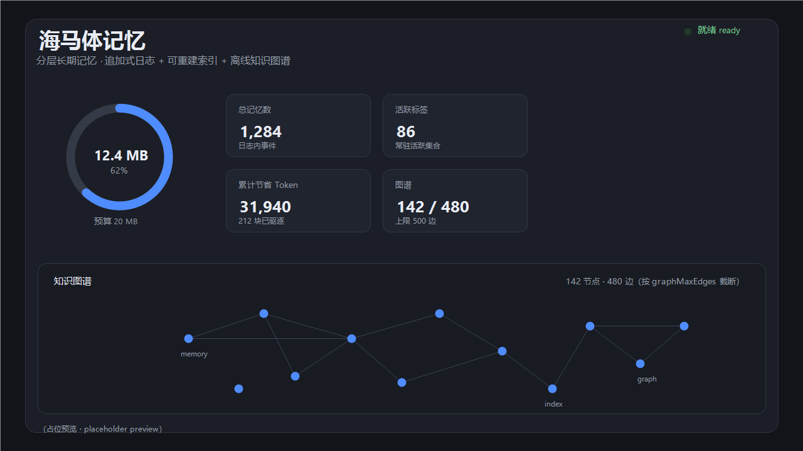
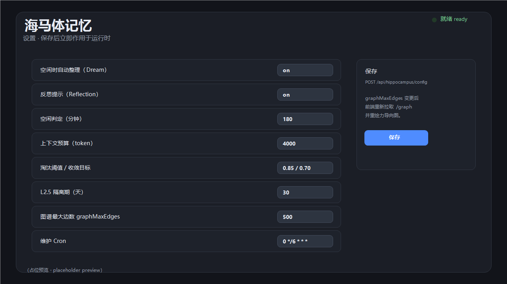
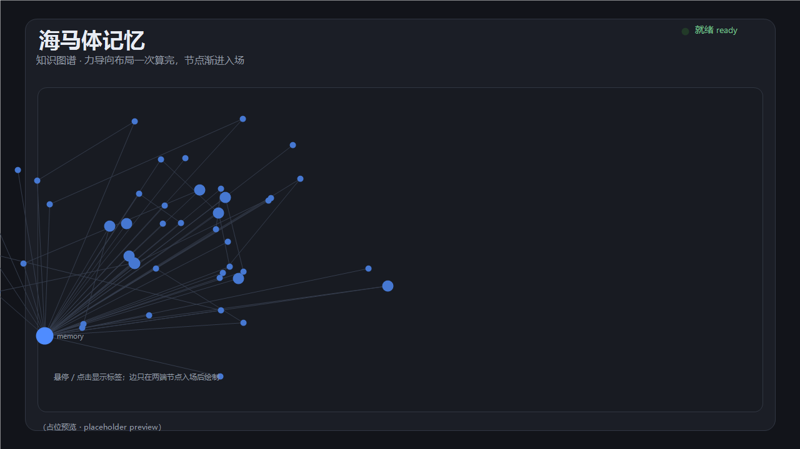

# dsh-layers-hippocampus · 海马体记忆

给 DeepSeek Harness（DSH）智能体的**分层长期记忆**：追加式事件日志、可重建标签索引、按天日记、独立语义层、L2.5 趋势隔离、离线知识图谱，以及一个 Web 面板。

- **仓库**：<https://github.com/382quaii/dsh-Layers-Hippocampus>
- **包名**：`dsh-layers-hippocampus`（npm 包名只能小写；仓库名保留 `dsh-Layers-Hippocampus` 的规范拼写，*Hippocampus* 双 **p**）
- **许可证**：MIT
- **运行时依赖**：零。Host 半边只用 Node 内置模块，React 由 Harness 提供。
- **详细设计**：[docs/ARCHITECTURE.zh.md](docs/ARCHITECTURE.zh.md)

---

## 安装

### 从 GitHub

```bash
pnpm add "github:382quaii/dsh-Layers-Hippocampus#v1.0.0"
```

然后把 `dsh-layers-hippocampus` 加入 profile `package.json` 的 `dsh.profile.bundles`，或用插件管理器安装（它会自动追加 `cordis.patch.yml`）。

### 从 npm

```bash
pnpm add dsh-layers-hippocampus
```

### 通过插件管理器

```
plugin_manager action=install_bundle target=<目录或包名>
```

安装后 profile 里会出现这一行：

```yaml
- insert:
    - id: hippocampus
      name: "dsh-layers-hippocampus"
      config:
        briefing: true
```

安装后重启 Host（或重新启用该行）：Host 半边立即生效，UI 半边在下次页面加载时出现。

---

## 能做什么

| 工具（`memory_*` 前缀） | 用途 |
| --- | --- |
| `remember` | 追加一条长期记忆（按内容哈希幂等） |
| `recall` | 关键词 + 标签检索，带衰减加权 |
| `reinforce` | 确认一次记忆，不重写内容 |
| `forget` / `restore` | 墓碑与反墓碑 |
| `admin` | `status` / `maintain` / `list-tags` / `trends` |

一切都从**唯一真相源**（追加式日志）派生；索引、日记、活跃标签集、知识图谱都是可丢弃、可重建的投影。

### 分层

1. **L1 事件日志**：追加式 JSONL 代际 + `CURRENT` 指针。
2. **L2 索引**：标签表、活跃集合、日记、墓碑；A/B 双缓冲，读者永远看不到半成品。
3. **L2.5 趋势隔离**：短命观察，经晋升窗口与突发检测才升级为记忆（情景可删，模式不删）。
4. **L3 语义层**：摘要独立于原始日志生死。
5. **图谱**：标签共现网络的离线投影。

### 身份纪律

- `content_hash` 规范化（标签排序、文本规整）用于**等价**。
- `event_id = hash(content_hash + event_time + occurrence_index)` 用于**身份**。
- 重复写通过独立幂等索引抑制；墓碑在日志压实后仍然存在，遗忘的事件不会复活。

---

## 配置

全部由 `resolveConfig` **fail-fast 校验**（绝不静默取整），启动与 HTTP 热更新走同一个校验器。

| 键 | 默认 | 范围 / 取值 |
| --- | --- | --- |
| `dataDir` | `<DSH_HOME>/memory` | 绝对路径 |
| `migrateFrom` | `null` | 路径；留空时自动探测旧目录 |
| `maintenanceCron` | `0 */6 * * *` | 5 段 cron，必须能触发 |
| `enableDream` | `true` | 布尔 |
| `dreamIdleMinutes` | `180` | 1 – 525 600 |
| `enableReflection` | `true` | 布尔 |
| `graphMaxEdges` | `500` | 100 – 2000 |
| `maxRecallTopK` | `100` | 1 – 1000 |
| `retrieval.topK` | `20` | 1 – `maxRecallTopK` |
| `context.maxTokens` | `4000` | 256 – 1 000 000 |
| `context.threshold` / `context.target` | `0.85` / `0.7` | target < threshold < 1 |
| `temp.ttlDays` / `temp.promotionWindowDays` | `30` / `20` | promotion ≤ ttl |
| `identity.eventTimePolicy` | `content` | `content` \| `explicit` \| `ingest` |

错误码稳定：`MEM_E_CONFIG_INVALID_CRON`、`MEM_E_CONFIG_OUT_OF_RANGE`、`MEM_E_CONFIG_UNKNOWN_KEY` 等。

### 调度纪律

Cron **和** 空闲 Dream 触发调用同一个入口 `runtime.runMaintenance(source)`。执行中再次触发直接拒绝（`maintenance-in-flight`）——不排队、不补跑。

### 启动状态机

`pending → in_progress → ready | failed`。

- `ready` 之前工具返回 `MEM_E_NOT_READY`；迁移窗口内 `recall` 重定向到旧目录（`readFrom: "legacy"`）。
- `failed` 通过 `/api/hippocampus/stats` 暴露错误，并可在面板里重试（`POST /api/hippocampus/retry`）。

---

## Web UI

三个注册，全部经 Harness 插槽服务：

| 插槽 | id / key | 内容 |
| --- | --- | --- |
| `sidebar.panellist` | `hippocampus-panel` | 图标（SVG，消费 `size`/`active`） |
| `main` | `hippocampus-panel` | 面板：存储环形图、统计卡、知识图谱 |
| `settings.section` | `hippocampus-settings` | 配置表单 |

- **环形图**：纯 SVG，中心同时显示用量与百分比；超出软预算时弧线截断为整圈并整体标红。
- **知识图谱**：力导向布局**只计算一次**并冻进 ref（弹簧 + 斥力 + 向心），随后逐个节点入场；边只在**两端节点都已入场**后绘制，不会出现悬空线；孤立节点带随机抖动。修改 `graphMaxEdges` 后按新上限重新拉取并重绘。
- UI 不调用 Agent 工具，只读下面的 JSON 路由。

### 截图







> 三张为**占位预览图**（本机没有浏览器截图工具时生成的 UI 示意图），用于让市场卡片先有内容；换成真机截图只需替换 `assets/` 下的同名 PNG，`screenshots.json` 无需改动。

## HTTP API

挂在 Host Web 服务上的同源路由，复用宿主浏览器鉴权。

| 方法 | 路径 | 返回 |
| --- | --- | --- |
| `GET` | `/api/hippocampus/stats` | `{ ok, phase, panel, briefing, config }`；未就绪 `503` |
| `GET` | `/api/hippocampus/config` | 可编辑配置子集 |
| `POST` | `/api/hippocampus/config` | `{ patch }` → 校验 → 生效 → 尽量持久化 |
| `GET` | `/api/hippocampus/graph` | 缓存图谱，`.slice(0, graphMaxEdges)` |
| `POST` | `/api/hippocampus/retry` | 重试 `failed` 启动（`202`） |

图谱路由**不排序、不读日志**：缓存由 `maintain()` 写入，路由只做切片。

---

## 数据布局

```
<dataDir>/
  log/          gen-*/ + CURRENT          追加式真相
  index/        gen-*/ + CURRENT          A/B 投影
  identity/     ledger.json               幂等 + 墓碑
  semantic/     摘要 + temp.json          独立语义流
  state/        context.json、maintenance.json、graph.json
  journal/      删除流水账
```

删掉 `index/` 或 `state/graph.json` 都安全：它们会从日志重建。

## 从旧名字迁移

存储位置不变（`<DSH_HOME>/memory`）。若数据在旧目录（`memory`、`dsh-memory`、`hippocampus`、`Layers-Hippocampus`、`dsh-Layers-Hippocampus`），在 `migrateFrom` 未设置且目标目录无数据时会**自动识别为迁移源**。迁移有 PID 存活锁与完成标记，可重复执行。

---

## 测试

```bash
npm test      # node test/run.mjs —— 105 个进程内用例，30 秒看门狗
npm run check # 语法检查 + 全量测试
```

全部用例在进程内运行（不 spawn 子进程），时间相关测试一律注入 `FakeClock`，不读真实时钟、不访问网络。

## 许可

MIT © 2026 382quaii
